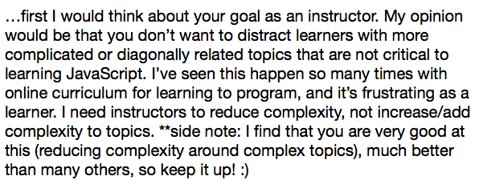
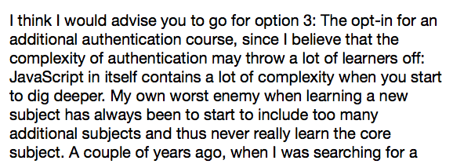
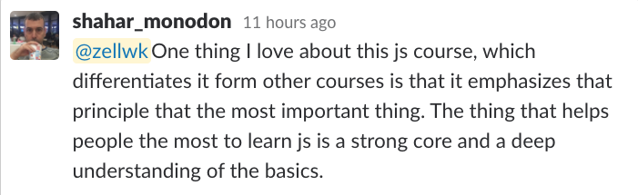

I asked [a question last week](https://zellwk.com/blog/should-i-teach-authentication-in-learn-javascript). I wanted to know if I should teach authentication in Learn JavaScript. Since I’m building Learn JavaScript for students like you, I wanted to hear your opinions.

If you’ve responded, I want to thank you for giving my an opinion. It helps. Thank you.

I read through a hundred responses. I gave myself a week to think through it. And I came to a conclusion.

I’m going to teach authentication in a separate course.

I want to share why I made this conclusion.

([Click here to read this article on the website](https://zellwk.com/blog/authentication-in-learn-js)).

## Why I’m teaching authentication in a separate course

To teach authentication, I need to teach students how to create servers. This means I’ll move students away from learning JavaScript to learning about servers.

Anything that moves students away from the product’s promise—to help you get so good JavaScript that you’ll be able to build things from scratch—is a no go.

Here’s why:

1. Students may get overwhelmed
2. Students need to learn fundamentals
3. There’s a lot to teach already

## Students may get overwhelmed

Many students who enroll in Learn JavaScript are new to JavaScript. They don’t know how to even use JavaScript. Most of them aren’t ready to learn about servers yet.

**I don’t want to overwhelm students by adding things they don’t need right now.** I want them to focus on JavaScript. I want them to be great at JavaScript. Other things can wait.

Some people responded with opinions that match my thoughts. For example, Nick said that I shouldn’t distract learners. I should reduce complexity.

Another example. Klaus said his enemy to learning is picking up too many subjects.

As a teacher, I’m here to help reduce complexity and increase focus so you can learn things well. I shouldn’t be adding complexity unless necessary.

**It’s important to teach the right things, in the right order, at the right time.** If I teach the right things in the right order at the right time, people learn.

I can teach authentication in Learn JavaScript, but I’ll be teaching it at the wrong time.

## Students need to learn fundamentals

Some people said I can create a server, then teach students to use the server I made. This way, I can teach authentication without diving deep into servers.

I disagree.

It’s not enough to teach students to use a server I made. They need to learn about the server environment. They need to learn to create their own servers. Students need to learn fundamentals, not abstractions.

**If they learn abstractions, they won’t understand what’s goes beneath the hood. When they don’t understand what goes beneath the hood, they think it’s magic. When they think it’s magic, they’ll get locked in. They’ll be afraid to leave it.**

I’ve seen this over and over with students who learn Bootstrap before CSS. They’ll use Bootstrap for every project, even if they shouldn’t use it. They cannot live without a CSS framework.

But students who learn CSS fundamentals can do without frameworks. They’re confident in their abilities. They can use a framework if they need to, but they’re not locked in.

**I want my students to feel confident in their abilities.**

This is why I focus on fundamentals. Shahar echoes my thoughts. He’s a student who went enrolled in Learn JavaScript.

This is also why I’m not going to make a server for my students. If I teach servers, I’ll teach students to create their servers (which is a huge topic).

## We have a lot to cover already.

**To learn Ajax, we need to learn about XHR and Fetch.** These two technologies let us perform Ajax operations.

To use XHR, we need to know about [callbacks](https://zellwk.com/blog/callbacks). To use Fetch, we need to know about [JavaScript Promises](https://zellwk.com/blog/js-promises).

I also want to teach Async/await. There are nuances in async/await that are not immediately obvious. I want to dedicate enough lessons to uncover these nuances.

We already have five topics to dive into here—XHR, Fetch, Callbacks, Promises, and Async/await. And we’re not done. There’s more.

**We need to know how to read API documentation**. If we know how to read documentation, we can make any request we want.

To read documentation, we need to understand requests and responses. We need to know what makes up a request. We also need to know what makes up a response.

We need to be able to set the correct method, the correct headers. We also need to know how to format the request body. We also need to understand [CURL](https://curl.haxx.se).

**We need to know how to handle Ajax errors**. I hope I don’t need to explain why. Error handling is important. We don’t want to tell our users “something went wrong” and leave them in the lurch.

To handle errors, we need to know when errors happen. We also need to know how to deal with them when we use XHR and Fetch.

**We need to know how to handle complicated requests**. What if we need three different resources at once? What if we receive a paginated resource? I want to teach students how to work through these real-world situations.

As you can see, there’s already a lot to learn about Ajax even if I exclude authentication.

But since authentication is important, I’ll also cover some authentication.

## What I’m covering about Authentication

You’ll learn how to perform basic authentication with XHR and Fetch. You’ll also learn how to perform OAuth authentication if you have an access token.

These are the fundamentals you need to know. They’re part of JavaScript.

You’ll also learn JSONP to use APIs that don’t support XHR and Fetch. JSONP is an older technology, but it’s an important one to understand if you don’t have access to a server.

## Wrapping up

I want my students to learn. That means I need to teach the right things in the right order at the right time.

**I can teach authentication in Learn JavaScript if I force it. But it’ll be in the wrong order. It’ll also be at the wrong time.** That’s why I’m going to create a separate course.

I’ll tell you more about the authentication course when I complete Learn JavaScript.
