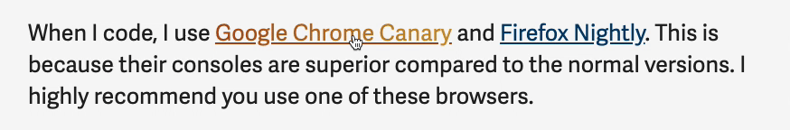

When I saw the CSS Tricks redesign, I was hooked. I loved the links with gradients. I told myself I’m going to use gradient links for my next project.

That’s what I did for Learn JavaScript’s course portal. The links look like this:

I want to share what I learned about creating gradient links.

Here’s the article. Enjoy!

[https://zellwk.com/blog/multi-line-gradient-links](https://zellwk.com/blog/multi-line-gradient-links)
