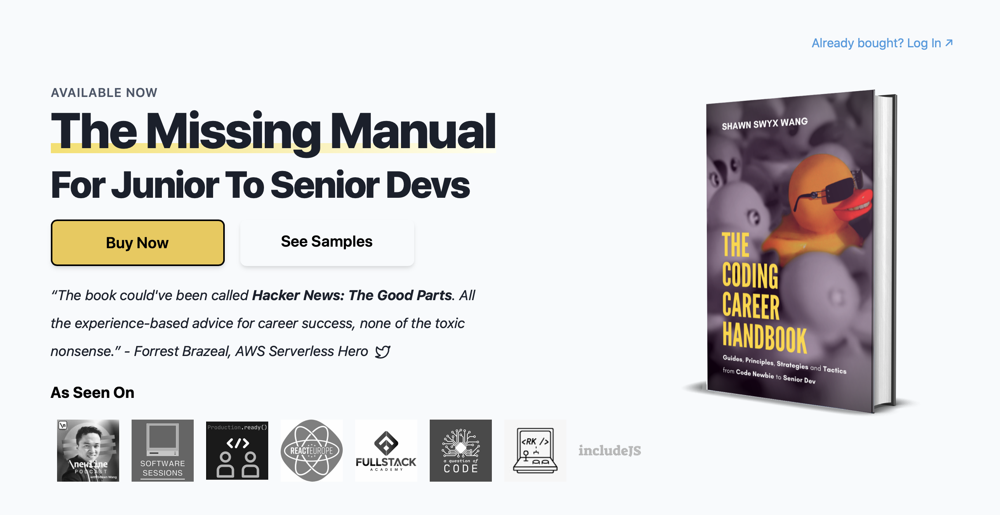
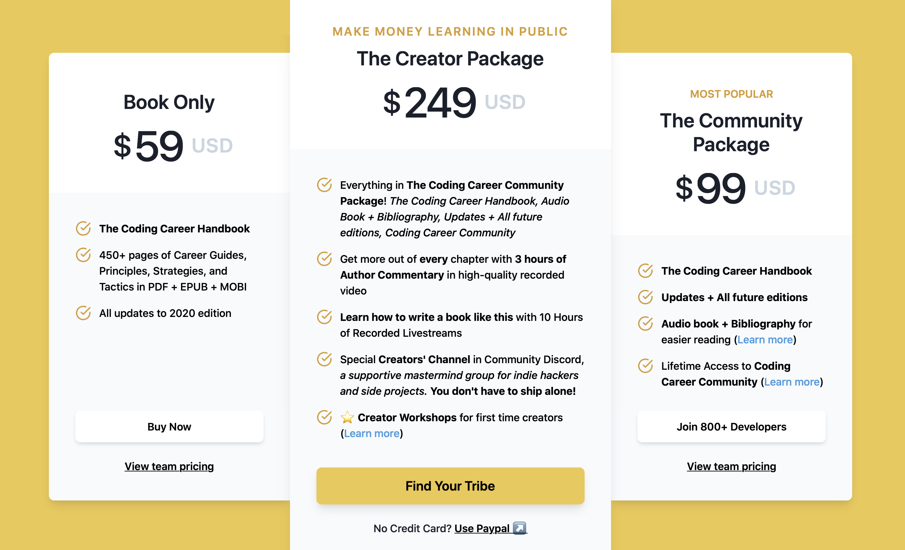

I am SO EXCITED to share this news with you today. I’m going to give away 99 copies of [The Coding Career Handbook](http://learninpublic.org/?a=zell) by [Shawn Wang](https://twitter.com/swyx).

These copies are at the second-tier package that’s priced at $99.

The Coding Career Handbook contains the following:

- Specific advice on every career stage: Code Newbie, Junior Dev, etc.
- Advice for job hunts between each career stage: First Job Hunt, Junior to Senior, and beyond Senior.
- Principles to help grow your network and expertise as you learn
- Strategies to bet on technologies to learn, careers to choose, and software business models to use.

**If you’re looking for a coding job, THIS is the book you need to have.**

Check out the [table of contents](https://www.learninpublic.org/toc?a=zell) if you’re interested.

I have some rules for this giveaway (which I’ll share below). BUT FIRST, let me tell you about Shawn, how awesome he is, and why he’s the right person to help you **crack your coding career**.

## Who is this Shawn guy?

Shawn Wang, more publicly known as [swyx](https://twitter.com/swyx) has the following job track record:

- Equities analyst at some investment bank (non-coding-related)
- Quit his cushy $350k/year banking job to learn Full-Stack web development at some Bootcamp
- Got a job at some unknown investment company as a developer
- **JUMPED TO NETLIFY** as a DX engineer after working for 6 months.
- Switched to Amazon Web Services as a Senior Dev Advocate after another 2 years.

**Shawn went from 0 experience in coding to working at Netlify in one year.** What’s more, Netlify and Gatsby both reached out to Shawn at the same time, so he had choices too.

Imagine if you could go from knowing nothing about code, to working at an industry-acclaimed place like Netlify or Gatsby IN ONE YEAR. How different would your life be?

If that’s not amazing, I don’t know what is.

Shawn is an expert at marketing himself as a developer. He’s so much better than me, and I have more to learn from him. **I bought 100 copies, but I’m only giving away 99** because I WANT TO KEEP ONE COPY FOR MYSELF TOO.

You can already tell how excited I am to share Shawn’s work with you.

But just in case you needed more validation about Shawn:

- He teaches at [Egghead.io](https://egghead.io/instructors/shawn-wang) (which says a lot)
- He does lots of open source work. (See his [about page](https://www.swyx.io/about)
- He moderates the [React community](https://www.reddit.com/r/reactjs/) in Reddit

So yes. I’m excited to share The Coding Career Handbook with you.

## Details of the giveaway

There’s only ONE rule: **If you can afford the book, please get the book from Shawn directly**. Here’s [a link you can use](http://learninpublic.org/?a=zell) (affiliate link).

I want to help people who are underprivileged here, which is why I bought so many copies of the book to give away. I know there are many people who need this kind of help.

So if you WANT the book, but cannot afford it, [go fill up this form](https://4eyes.io/s/9efRa/) to enter the giveaway. In this form, I’ll ask you a few questions to help me better create content for you.

Here’s how it’s going to work:

1. I’ll collect responses until 9 September 2020.
2. You will only be eligible for the giveaway if you answered all questions in the form
3. I will randomly pick 99 people from the people who entered this giveaway
4. I will publicly release an email on 16 September 2020 to notify the winners.

This selection process is highly based on trust and luck. I trust you to be honest, and I wish you good luck. Please [grab the book directly from Shawn](http://learninpublic.org/?a=zell) if you have the funds. Let less privileged people have a chance to get to a better place.

That’s it!

If you enjoyed this article, please tell a friend about it! Share it on [Twitter](https://twitter.com/share?text=Giving%20away%2099%20copies%20of%20The%20Coding%20Career%20Handbook%20by%20Shawn%20Wang%20by%20@zellwk%20%F0%9F%91%87%20&url=https://zellwk.com/blog/coding-career-handbook/). If you spot a typo, I’d appreciate if you can correct [it on GitHub](https://github.com/zellwk/zellwk.com/blob/master/src/posts/2020-09-02-coding-career-handbook.md).
