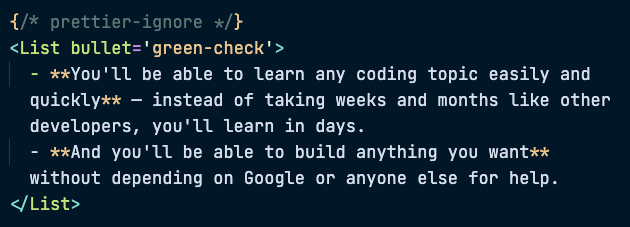
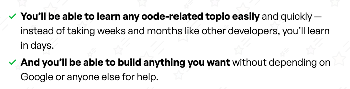

I finally migrated my website from Eleventy to Astro!

In celebration of this, I want to show you something nice.

Today, I’m going to show you how to build fancy list items with Astro, so you can use bullet points for SVG with any markdown list.

Here’s what you write.

Here’s what gets rendered.

[Here’s the link for today’s article](https://zellwk.com/blog/astro-fancy-list-item/).

Enjoy!

I have lots more to share about building with Astro!
