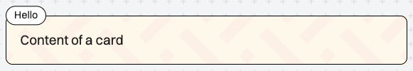
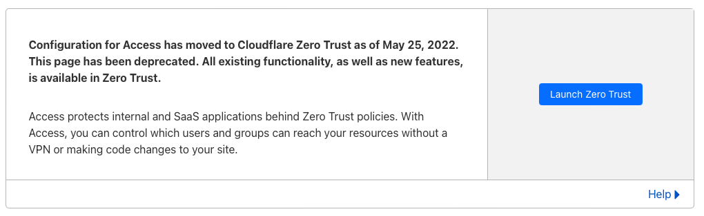
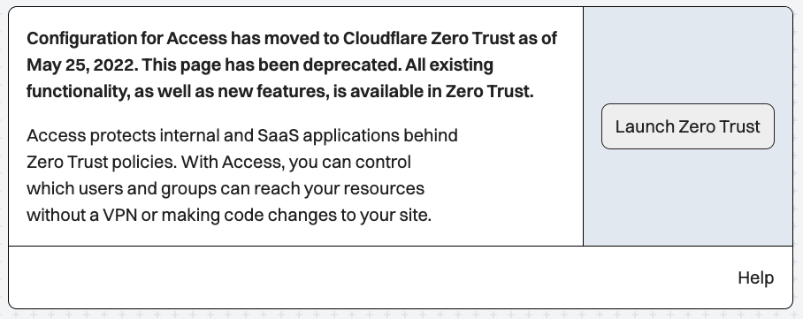

Happy Chinese New Year (if you’re celebrating it! 🍊).

I’ve been hard at work over the past week (even today!) to bring Splendid Layouts to you, as promised in my last email.

If you have purchased Splendid Layouts already, you can find the link to access it in a separate email that I just sent out to you as well.

If you have not purchased Splendid Layouts yet, you might want to consider getting it over [here](https://magicaldevschool.com/css-layout-patterns/) (it’s still called CSS Layout Patterns because I haven’t changed the name on the website yet).

## This is my best work so far.

I’m incredibly proud of it.

I’ve never seen an easier way to create layouts in my life — after spending over 10 years as a frontend developer — while being heavily immersed in this world.

**This is probably the best layout system you will see on the internet today**.

I’m biased, but to me, it’s so good that I would _never_ revert to any of the previous methods I’ve tried before — including Susy, pure CSS, pure Tailwind, etc.

And I’ll prove just how good it is right in this email.

## Here’s a sneak peek

If you’ve ever created a two-sidebar (or even single-sidebar) layout, you know how tough it is.

Now you can make one with a tiny HTML structure — and not even have to worry about CSS! (I hate to send GIFs here because they’re so darn big. So [click here to see the example on X](https://x.com/zellwk/status/1756015250376437980?s=20))

For this sort of functionality, you _only_ have to write a little bit of HTML…

Just imagine how much is already done for you! And… the code is so readable! 😍

### Here’s another one.

Imagine you want to create a card like this with an SVG background and a pill popping up at the top left hand corner.

Creating this sort of layout would have taken A LONG TIME if you were to write the HTML and CSS from scratch. (Or even if you used Tailwind from Scratch).

No longer now. You just need to combine a couple of classes from Splendid Layouts and you’ll get it in SECONDS — this is so easy it almost seems like magic.

### I have another example — a real one.

Let’s say you want to create a really complex card that’s divided up into multiple sections, like this one on Cloudflare.

How would you build this?

Well, guess what? In Splendid Layouts, all you have to do is through up a Card component plus a couple of dividers and you’re basically done.

Here’s the code that I wrote in a couple of seconds…

And here’s the output…

Don’t the styles look awfully similar?

**I must say, it’s pretty cool that I got this layout in just a couple of seconds!**

And what’s the alternative?

I can think of two:

1. Build a custom component for this card by experimenting with the HTML and CSS…
2. Search through Tailwind UI or some other component library, hoping you’ll find this layout, and copy it…

Neither sounds appealing to me — I’d rather build this up in seconds than scour the internet for hours. Wouldn't you too?

Moving on…

## Patterns will soon rain

I promised to build many real-world patterns for you to use after the documentation. This is exactly what I’ll be working on in the next couple of weeks.

If you have a pattern you would love to include, just let me know and I’ll prioritize building those.

But before that, I’m gonna take a week off and recover from my illness a little bit, before diving back to work. So I hope to give you good news soon.

## Wanna get Splendid Layouts?

I hope I showed you just _how_ powerful this layout system is. I’m not kidding when I say it’s literally the best thing I’ve ever seen.

The price is unbeatable right now — only $49 for this sort of layout system. Imagine what you can do after you understand the system I’m giving you!

Now, I hope you forgive me for harping on this project. I can’t help it. I’m incredibly excited to share this with you. And yet, I’m also incredibly scared about talking about it all day long.

If what I’ve shared about Splendid Layouts interests you, please feel free to [get yourself a license](https://magicaldevschool.com/css-layout-patterns/).

If you don’t wish to purchase it, I hope you allow me to share my enthusiasm and not get offended.

That’s it for today.

I hope you had a great week. And that you’re going to have a blast the next week too.
